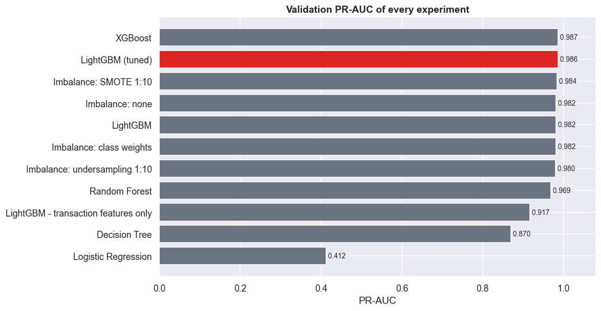
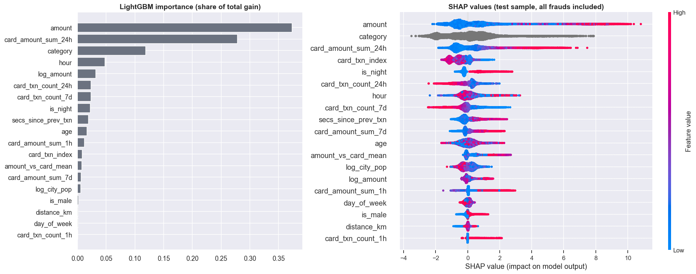

# Credit Card Transactions Fraud Detection

Detecting fraudulent card transactions with a leak-free feature pipeline and a strict time-based evaluation.
The final LightGBM model was trained on January 2019 to June 2020 and evaluated once on the following six months.

| Test metric (Jun - Dec 2020) | Value |
|---|---|
| PR-AUC | 0.978 (random model: 0.004) |
| ROC-AUC | 0.9995 |
| Recall / Precision at the cost-optimal threshold | 0.970 / 0.781 |
| Recall at 90 % precision | 0.948 |
| Share of fraud dollars caught | 98.8 % |
| Alerts per day | about 14 |

(!) The data is **simulated** and its fraud patterns are regular, so a real fraud system would score far lower.
The value of this project is the method.

## Problem

About 0.5 % of transactions are fraud, so accuracy is useless: a model that never flags anything scores 99.4 %.
The goal is to catch as much fraud as possible while keeping the number of alerts worth reviewing.

## Data

[Credit Card Transactions Fraud Detection](https://www.kaggle.com/datasets/kartik2112/fraud-detection) on Kaggle:
1.85 million simulated transactions, about 1,000 cards, January 2019 to December 2020.
The data is **not included in this repository**. To get it:

```bash
kaggle datasets download -d kartik2112/fraud-detection -p data/raw --unzip
```

## Approach

| Notebook | Content |
|---|---|
| [01 Data Understanding](notebooks/01_data_understanding.ipynb) | Data dictionary, data health, imbalance, how train and test relate in time |
| [02 EDA](notebooks/02_eda.ipynb) | Fraud patterns, Mann-Whitney U and chi-square tests with effect sizes, correlation |
| [03 Feature Engineering](notebooks/03_feature_engineering.ipynb) | Past-only card history features, brute-force leakage check, time-based split |
| [04 Modeling](notebooks/04_modeling.ipynb) | Baselines, ensembles, feature ablation, imbalance strategies, learning curve, Optuna |
| [05 Evaluation & Explainability](notebooks/05_evaluation_explainability.ipynb) | Cost-based threshold, test results, calibration, SHAP, error analysis, stability |

**Avoiding leakage.** Every per-card feature uses only that card's earlier transactions, in the window `[t - W, t)`.
The fast rolling features were verified against a brute-force recomputation (200 random transactions, 0 mismatches).
Data is split by time: train to 2020-03-20, validation to 2020-06-21, test to 2020-12-31.

## Results

Validation PR-AUC of the main experiments:

| Experiment | PR-AUC |
|---|---|
| XGBoost | 0.9870 |
| LightGBM, tuned with Optuna (final model) | 0.9863 |
| LightGBM, default | 0.9819 |
| Random Forest | 0.9691 |
| LightGBM without card history features | 0.9168 |
| Decision Tree | 0.8702 |
| Logistic Regression | 0.4123 |

XGBoost and tuned LightGBM are effectively tied; LightGBM was kept because it trains about 4x faster.
Validation scores of the boosting models are slightly optimistic because the same period drives early stopping.



What the project found:

- **Card history matters.** Removing it lowers PR-AUC from 0.982 to 0.917 and recall from 0.94 to 0.82.
- **Imbalance strategy barely matters.** No rebalancing, class weights, undersampling and SMOTE all land between 0.980 and 0.984.
- **The threshold is a business decision.** With a $10 review cost, the best threshold is 0.02 rather than the F1-optimal 0.37.
- **Remaining misses are cheap.** 50 of the 65 missed frauds are under $200, and recall is at least 98.6 % above $200.
- **Calibration is partial.** Scores are reliable at the extremes but under-confident in the middle (0.17 predicted, 0.39 observed).
- **Precision drops in December** (0.66 against 0.75-0.82 in most months), when holiday spending raises false alarms.



## Project structure

```
notebooks/          numbered notebooks, read in order
src/                data loading, features, metrics, plot style
data/raw/           Kaggle CSV files (git-ignored)
data/processed/     Parquet splits (git-ignored)
models/             trained models (git-ignored)
reports/            metrics and figures
```

## How to run

Python 3.10.

```bash
pip install -r requirements.txt
# download the data as shown above, then run notebooks 01 to 05 in order
```

Notebook 04 takes about 50 minutes on a 12-core CPU; the others take a few minutes each.

## Run on Kaggle

[`kaggle/ml-binaryclassification-credit-card-transactions-fraud-detection.ipynb`](kaggle/ml-binaryclassification-credit-card-transactions-fraud-detection.ipynb) is notebooks 01 to 05 in one file, with `src/` written to disk in its first cells.

1. Kaggle → Create → **Import Notebook** → upload the file (or paste its GitHub URL)
2. **Add Input** → dataset `kartik2112/fraud-detection`
3. Settings → Internet **On** (installs `optuna`, `imbalanced-learn`) → CPU is enough
4. Run All → outputs land in `/kaggle/working` (`data/processed/`, `models/`, `reports/`)
